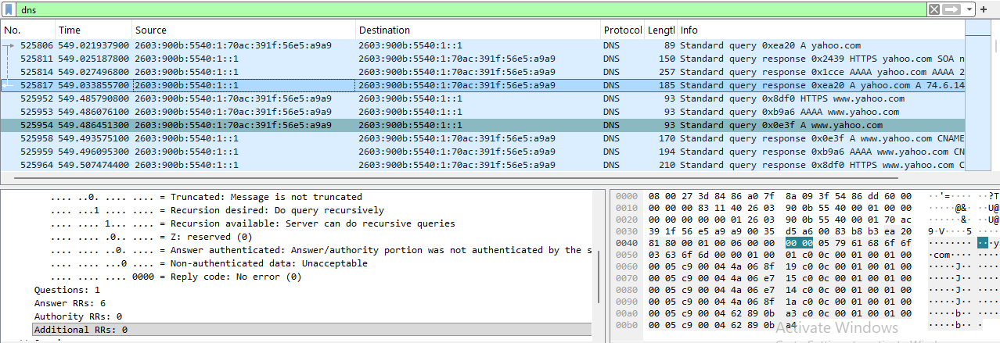
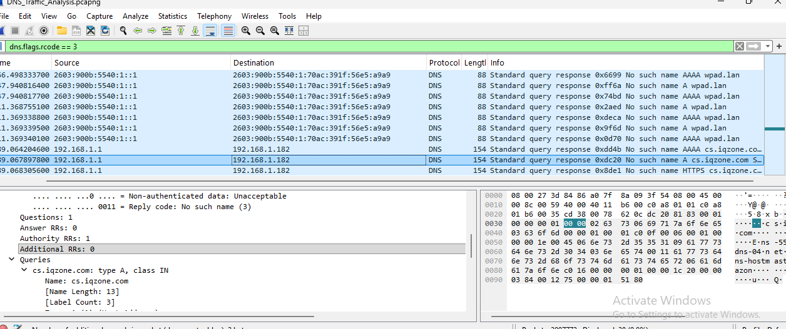
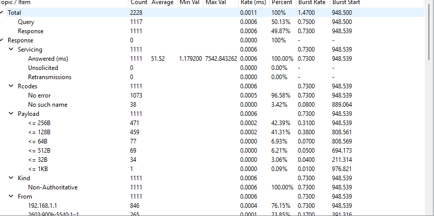
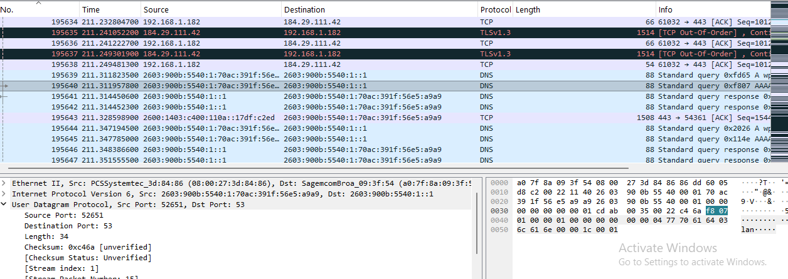

# Wireshark-Network-Security-Analysis
Hands-on network security analysis using Wireshark to investigate DNS traffic, NXDOMAIN errors, IP addresses, and potential security threats.

## Project Overview

This project demonstrates hands-on network traffic analysis using Wireshark in a Windows 11 virtual machine.

The objective was to investigate DNS traffic, identify successful and failed DNS lookups, examine source and destination IP addresses, and evaluate potential indicators of suspicious network activity.

During the investigation, 2,228 DNS messages were analyzed, including 1,117 queries and 1,111 responses.

The analysis identified 38 NXDOMAIN responses, including failed DNS lookups involving wpad.lan and cs.iqzone.com.

This project demonstrates practical SOC Analyst skills, including packet analysis, DNS investigation, network monitoring, and security documentation.

**Final Result:** No confirmed malicious DNS activity was identified in the traffic examined.

## Lab Environment

The network security analysis was performed in a virtual lab environment using Oracle VirtualBox.

**Lab Configuration:**

- Virtualization Platform: Oracle VirtualBox
- Operating System: Windows 11 Pro
- Network Analysis Tool: Wireshark
- Packet Capture Format: PCAPNG (.pcapng)
- Analysis Focus: DNS queries, responses, NXDOMAIN errors, and IP address identification

**Lab Setup:**

Wireshark was installed on the Windows 11 virtual machine to capture and analyze network traffic.

Network traffic was generated through normal web browsing, including DNS requests for yahoo.com.

The captured traffic was saved as DNS_Traffic_Analysis.pcapng for further investigation.

Wireshark display filters and DNS statistics were used to examine network communications and identify potential security concerns.

## Tools Used

**Wireshark**
- Captured and analyzed network traffic.
- Applied display filters to investigate DNS queries and responses.
- Examined NXDOMAIN errors and DNS response codes.
- Identified source and destination IP addresses.
- Reviewed DNS traffic statistics to identify unusual network activity.

**Oracle VirtualBox**
- Provided the virtualized environment for the network security lab.
- Hosted the Windows 11 virtual machine used for packet analysis.

**Windows 11 Pro**
- Served as the operating system for the network investigation.

**Windows Snipping Tool**
- Captured screenshots of DNS packets, traffic statistics, and investigation findings.

**Notepad**
- Used to create and document the SOC Network Traffic Analysis Report.

- ## Investigation Methodology

The network security investigation was conducted using Wireshark to capture, filter, and analyze DNS traffic.

### 1. Network Traffic Capture
- Launched Wireshark inside the Windows 11 virtual machine.
- Selected the active network interface.
- Captured network traffic while browsing websites, including yahoo.com.
- Saved the packet capture as `DNS_Traffic_Analysis.pcapng`.

### 2. DNS Traffic Filtering
Applied Wireshark display filters to examine DNS communications:

- `dns` — Display DNS packets.
- `dns.flags.response == 0` — Display DNS queries.
- `dns.flags.rcode == 3` — Identify NXDOMAIN responses.

### 3. DNS Query and Response Analysis
- Examined DNS queries and their corresponding responses.
- Identified six IPv4 addresses returned for yahoo.com.
- Reviewed DNS response codes and response times.

### 4. NXDOMAIN Investigation
- Identified 38 NXDOMAIN responses.
- Investigated failed DNS lookups involving `wpad.lan` and `cs.iqzone.com`.
- Evaluated whether the observed activity indicated potential security concerns.

### 5. Source IP Investigation
- Located the original DNS request associated with an NXDOMAIN response.
- Identified source and destination IPv6 addresses.
- Traced the DNS request for `wpad.lan` to its originating network address.

### 6. Security Assessment and Documentation
- Reviewed DNS traffic statistics.
- Documented findings and supporting evidence.
- Evaluated potential indicators of suspicious network activity.
- Prepared a SOC Network Traffic Analysis Report.

**Investigation Outcome:** No confirmed malicious DNS activity was identified in the traffic examined.

## DNS Analysis Results

### DNS Traffic Statistics

Wireshark DNS statistics were reviewed to identify successful and failed domain name resolution activity.

| DNS Statistic | Result |
|---|---|
| Total DNS Messages | 2,228 |
| DNS Queries | 1,117 |
| DNS Responses | 1,111 |
| No Error Responses | 1,073 |
| NXDOMAIN Responses | 38 |
| NXDOMAIN Response Rate | 3.42% |
| Average DNS Response Time | 51.52 ms |

### Successful DNS Resolution

A DNS query for `yahoo.com` successfully returned six IPv4 addresses:

- `74.6.143.25`
- `74.6.231.21`
- `74.6.231.20`
- `74.6.143.26`
- `98.137.11.163`
- `98.137.11.164`

**DNS Response Details:**
- Query Type: A (IPv4)
- Response Code: No error (0)
- Answer Records: 6
- Response Time: 11.9178 milliseconds
- Packet Number: 525817

### Failed DNS Resolution (NXDOMAIN)

Two domains were investigated after receiving NXDOMAIN responses:

**Domain 1: `wpad.lan`**
- Query Type: AAAA (IPv6)
- Response Code: NXDOMAIN (3)
- Response Time: 2.4928 milliseconds
- Possible Explanation: Automatic proxy discovery activity

**Domain 2: `cs.iqzone.com`**
- Query Type: A (IPv4)
- Response Code: NXDOMAIN (3)
- Response Time: 13.4854 milliseconds
- Assessment: Additional context would be required to determine why the lookup failed.

### Source IP Analysis

The original DNS request for `wpad.lan` was traced using Wireshark.

- Original Request Packet: 195640
- Response Packet: 195641
- Source IPv6: `2603:900b:5540:1:70ac:391f:56e5:a9a9`
- Destination IPv6: `2603:900b:5540:1::1`

The investigation demonstrated how DNS queries and responses can be correlated to identify the originating network device.

### Analysis Summary

The majority of DNS responses returned without errors. The 38 NXDOMAIN responses represented approximately 3.42% of the DNS responses examined.

No confirmed malicious DNS activity was identified from the evidence reviewed.

## Security Findings

### Finding 1: Successful DNS Resolution

DNS queries for `yahoo.com` returned six IPv4 addresses.

The observed activity was consistent with normal DNS resolution, and no suspicious behavior was identified in the examined exchange.

### Finding 2: NXDOMAIN Responses

Wireshark statistics identified 38 NXDOMAIN responses out of 1,111 DNS responses, representing approximately 3.42%.

NXDOMAIN responses may result from mistyped domain names, application configuration issues, or automated DNS activity.

These responses alone do not confirm malicious behavior.

### Finding 3: WPAD Domain Activity

The domain `wpad.lan` returned an NXDOMAIN response.

This activity may be associated with Web Proxy Auto-Discovery Protocol (WPAD), which allows systems to discover network proxy settings.

Although WPAD can be associated with certain security risks, the observed DNS request did not establish evidence of an attack.

### Finding 4: Additional Failed Domain Lookup

The domain `cs.iqzone.com` also returned an NXDOMAIN response.

Additional endpoint and application information would be required to determine the cause of the failed lookup.

### Finding 5: Source IP Identification

The original DNS request for `wpad.lan` was traced to its originating IPv6 address.

This demonstrated the ability to correlate DNS queries and responses and identify the source of network activity.

### Overall Security Assessment

No confirmed malicious DNS activity was identified in the examined traffic.

The investigation demonstrated the importance of analyzing DNS errors, identifying network endpoints, and correlating evidence before escalating potential security incidents.

### Recommended Follow-Up Actions

- Monitor repeated DNS failures involving unfamiliar domains.
- Investigate unusually frequent DNS requests from individual endpoints.
- Correlate suspicious DNS activity with endpoint security logs.
- Review suspicious domains using trusted threat intelligence sources.
- Escalate activity when additional evidence indicates a potential security threat.

- ## Final Assessment

### Investigation Conclusion

A network security investigation was successfully conducted using Wireshark in a Windows 11 virtual machine.

The investigation focused on DNS traffic analysis, identifying successful and failed domain lookups, examining DNS response statistics, and tracing network requests to their originating IP addresses.

### Key Accomplishments

- Captured and analyzed network traffic using Wireshark.
- Examined 2,228 DNS messages, including 1,117 queries and 1,111 responses.
- Identified 38 NXDOMAIN responses.
- Investigated DNS resolution for `yahoo.com`.
- Analyzed failed DNS lookups involving `wpad.lan` and `cs.iqzone.com`.
- Identified source and destination IPv6 addresses associated with a failed DNS request.
- Collected screenshots and documented investigation findings.

### Final Security Verdict

**No confirmed malicious DNS activity was identified in the traffic examined.**

The observed DNS failures may be associated with normal network behavior, application configuration issues, or unsuccessful domain resolution attempts.

Additional endpoint logs and threat intelligence would be required before classifying the observed activity as malicious.

### SOC Analyst Skills Demonstrated

- Network packet capture and analysis
- DNS protocol investigation
- IPv4 and IPv6 traffic analysis
- DNS error identification
- Source and destination IP analysis
- Security event triage
- Evidence collection and documentation
- Security investigation reporting

### Project Status

**DNS Investigation Completed — No Confirmed Security Incident**

The project demonstrates practical network investigation and documentation skills relevant to a SOC Analyst position.

## Screenshots and Evidence

The following screenshots document the DNS traffic investigation performed using Wireshark.

### 1. DNS Response Analysis

Shows the successful DNS resolution of yahoo.com and the six IPv4 addresses returned.

### 2. NXDOMAIN Investigation

Shows the investigation of failed DNS lookups and NXDOMAIN response codes.

### 3. DNS Traffic Statistics

Shows the DNS query and response statistics, including the 38 NXDOMAIN responses identified during the investigation.

### 4. Source IP Analysis

Shows the original DNS request and the source and destination IPv6 addresses.

## Investigation Report

The complete investigation report documents the analysis methodology, DNS findings, security assessment, and final conclusions.

[View Wireshark Network Traffic Analysis Report](Wireshark_Network_Traffic_Analysis_Report.txt)
